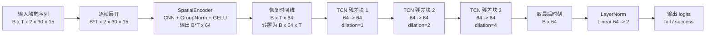

# 当前网络结构

当前训练使用 `models/force_cnn_tcn.py` 中的 `ForceCnnTcn`，是第一阶段的
成功/失败二分类基线，不是后续计划中的 CPF-FusionNet。

## 总体结构



## 空间编码器

每个时间帧独立通过同一个 CNN，输入为 `[2, 30, 15]`：

```text
Conv2d(2, 16, 3, padding=1)       -> [16, 30, 15]
GroupNorm(4, 16) + GELU
Conv2d(16, 32, 3, stride=2)       -> [32, 15, 8]
GroupNorm(8, 32) + GELU
Conv2d(32, 64, 3, stride=2)       -> [64, 8, 4]
GroupNorm(8, 64) + GELU
AdaptiveAvgPool2d((4, 2))         -> [64, 4, 2]
Flatten                           -> 512
Linear(512, 64) + LayerNorm + GELU -> 64 维帧特征
```

经过逐帧编码后：

```text
[B, T, 2, 30, 15] -> [B, T, 64] -> [B, 64, T]
```

## 时间编码器

时间部分是 3 个因果一维卷积残差块，每个块包含两层 `CausalConv1d`：

```text
Block 1: kernel=3, dilation=1, dropout=0.1
Block 2: kernel=3, dilation=2, dropout=0.1
Block 3: kernel=3, dilation=4, dropout=0.1
```

每层卷积后使用：

```text
ChannelLayerNorm -> GELU -> Dropout
```

每个块都有残差连接，通道数始终为 64。因果卷积只访问当前和过去帧，不使用未来
信息。三个块、每块两层卷积、`kernel=3`、膨胀率 `1/2/4` 时，最后时刻的理论感受野
为 29 帧；当 `T=40` 时，模型主要利用窗口末尾的 29 帧。

## 分类头

```text
TCN 输出 [B, 64, T]
取最后时间步 -> [B, 64]
LayerNorm(64)
Linear(64, 2)
输出 logits [B, 2]
```

类别对应关系：

```text
logit 0 -> fail
logit 1 -> success
```

推理时通过 `argmax` 得到最终 episode 级预测。模型参数量约为 `131,650`。

## 当前训练输入和输出

```text
输入：首次接触窗口 force_map，默认 [B, 40, 2, 30, 15]
标签：episode 级 success/result，0=fail，1=success
输出：episode 级二分类 logits [B, 2]
```

虽然 NPZ 中已经保存了 `state_label` 四分类逐帧标签，但当前网络尚未直接训练这四类
状态。后续升级 CPF-FusionNet 或四分类时序模型时，需要同步修改数据集输出、分类头和
评估指标。

## 对应代码

```text
models/force_cnn_tcn.py   网络定义
training/data.py          T 窗口截取和输入张量
train.py                  损失、优化器和训练循环
```
